# `course_code` 各小节领域模型与业务规则

本文按 `week01`～`week03` 共 17 个小节整理。图依据当前代码抽象；具体状态码以源码为准。`2-5` 的实现保存在压缩包内，以修复超时版本为准。

以下命令以 Windows PowerShell 和仓库根目录为起点。运行 Python 命令前先执行 `conda activate AiAgent`，并用 `$env:CONDA_DEFAULT_ENV` 确认输出为 `AiAgent`。各表中的“预期现象”是验证标准；涉及模型或外部服务的命令须先配置相应密钥和服务。

## 图示约定

架构图包含组件(components)、边界(boundaries)、连接(connections)；工作流图包含泳道(lanes)、阶段(phases)、分组(groups)、主路径(mainPath)、节点(nodes)、连线(edges)；时序图包含参与者(participants)、片段(segments)、消息(messages)、激活区(activations)；生命周期图包含泳道(lanes)、状态(states)、迁移(transitions)。

## week01

### 1-1 首个代理循环

**代码依据**：[agent_loop_demo.py](./week01/1-1/agent_loop_demo.py)、[sandbox_runner.py](./week01/1-1/sandbox_runner.py)、[eval_runner.py](./week01/1-1/eval_runner.py)。

**领域词汇表**

| 术语 | 含义 |
| --- | --- |
| 代理上下文(Agent Context) | 保存消息与可用工具 |
| 工具调用(Tool Call) | 模型提出的动作请求 |
| 工具结果(Tool Result) | 运行时执行后的回填消息 |
| 评测用例(Eval Case) | 期望工具、参数与答案的样例 |

**业务规则**

1. 模型仅提出工具调用；代理循环按名称调度并回填结果，直到模型不再请求工具。
2. 运行代码放入临时目录，三秒超时并返回退出码、输出及错误类型；天气工具返回模拟数据。
3. 评测同时检查工具选择、参数与答案包含项。

#### 功能说明

| 对象与功能 | 运行及验证步骤（PowerShell） | 预期现象 |
| --- | --- | --- |
| `agent_loop_demo.py`：调用 DeepSeek，在代理循环中分派天气查询或临时 Python 执行。 | 1. 从仓库根目录执行 `Set-Location course_code/week01/1-1` |  |
|  | 2. 设置 `$env:DEEPSEEK_API_KEY='你的密钥'` |  |
|  | 3. 运行 `python -m agent_loop_demo`。 | 终端依次出现模型决策、工具结果和最终回答；`sandbox_runner.py` 由代理循环导入，不单独启动。 |
| `eval_runner.py`：读取 `eval_cases.json`，按测试样例统计代理结果。 | 在同一目录运行 `python -m eval_runner`。 | 逐例输出结果和通过率；此验证同样需要模型密钥及网络。 |

**架构图**。组件(components)：用户、代理循环、消息上下文、工具分派、模拟天气工具、模型服务、临时 Python 子进程；边界(boundaries)：代理循环内部、外部模型服务、临时执行环境；连接(connections)：模型决策、工具分派、结果回填与最终回答。代码中的模型调用是 `llm_complete` 函数，并没有独立的模型适配器类。

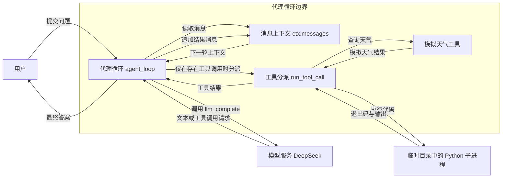

**工作流图**。泳道(lanes)：用户、代理循环、工具执行；阶段(phases)：提交问题 → 模型决策 → 有工具调用时执行 → 结果回填并再次决策 → 无工具调用时回答；分组(groups)：输入、循环、结束；主路径(mainPath)：提交问题 → 模型决策 → 判断 → 工具分支或最终答案；节点(nodes)：问题、模型请求、判断、工具执行、回填、回答；连线(edges)：工具结果回到模型请求，普通文本直接结束。

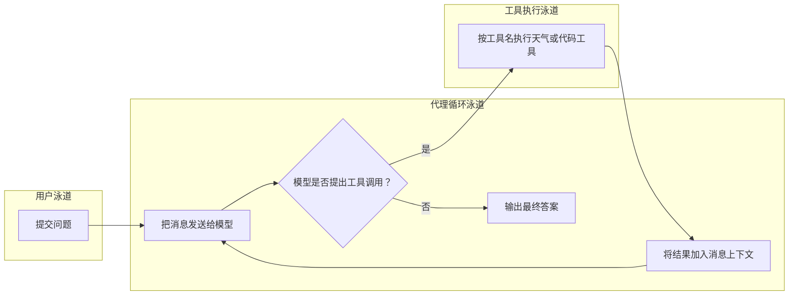

**时序图**。参与者(participants)：用户、代理循环、模型服务、工具分派；片段(segments)：循环调用模型、可选工具执行、最终回答；消息(messages)：问题、模型输出、工具调用与结果、最终答案；激活区(activations)：代理循环、工具分派。

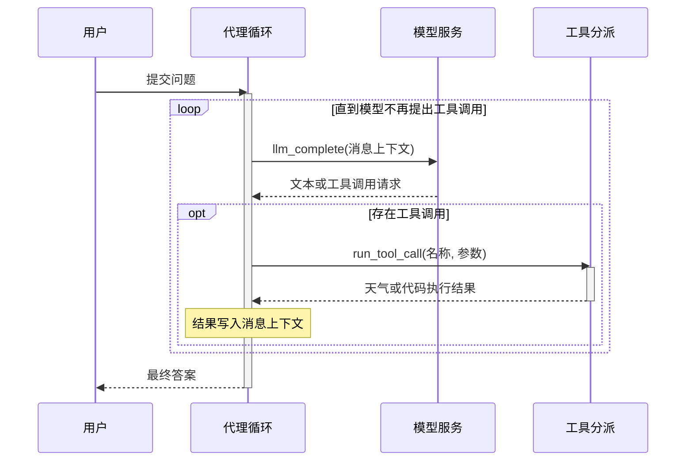

**生命周期图**。泳道(lanes)：代理循环、工具执行；状态(states)：待处理、等待模型、等待工具、已完成、失败；迁移(transitions)：模型返回工具调用则等待工具，工具结果回填后再次等待模型；模型直接回答则完成。

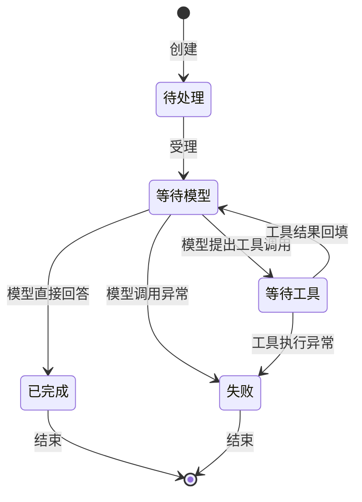

### 1-2 模型接口与适配

**代码依据**：[modelAdapter.py](./week01/1-2/modelAdapter.py)、[dsAdapter.py](./week01/1-2/dsAdapter.py)、[OpenAIAdapter.py](./week01/1-2/OpenAIAdapter.py)、[with_retry.py](./week01/1-2/with_retry.py)、[normalize_exception.py](./week01/1-2/normalize_exception.py)。

**领域词汇表**

| 术语 | 含义 |
| --- | --- |
| 模型请求(Model Request) | 统一系统提示、用户输入、采样与输出约束 |
| 模型结果(Model Result) | 文本、结构化数据、用量和请求号 |
| 模型能力(Model Capabilities) | 接口与结构化输出支持情况 |
| 模型调用错误(Model Call Error) | 带错误码和可重试标志的失败 |

**业务规则**

1. 适配器按供应商能力映射统一请求；结构化输出在解析后才成为数据。
2. 认证、错误请求和校验失败不可重试；限流、超时、网络及部分服务错误可重试。
3. 重试受最大次数、指数退避与总时限约束。

#### 功能说明

| 对象与功能 | 运行及验证步骤（PowerShell） | 预期现象 |
| --- | --- | --- |
| `tokens.py`：定义上下文预算和超限后的处理策略。 | 1. `Set-Location course_code/week01/1-2` |  |
|  | 2. 运行 `python -c "from tokens import budget, choose_context_action; print(budget.max_business_input, choose_context_action(100, budget))"`。 | 输出预算数值和 `keep`；模块中的策略函数可导入调用。 |
| `temp_top_p.py`：比较采样参数对真实模型回答的影响。 | 1. 在同一目录设置 `$env:DEEPSEEK_API_KEY='你的密钥'` |  |
|  | 2. 运行 `python -m temp_top_p`。 | 输出多组参数及对应回复；`dsAdapter.py`、`OpenAIAdapter.py` 等是接口教学片段，不能直接作为完整程序运行。 |

**架构图**。组件(components)：调用方、统一模型适配器、供应商接口、异常归一化器、重试器；边界(boundaries)：调用方、课程实现、外部依赖；连接(connections)：请求、校验、执行与回传。

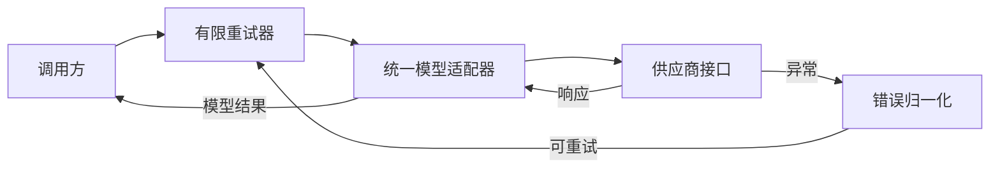

**工作流图**。泳道(lanes)：请求方、控制层、执行层；阶段(phases)：构造统一请求 → 检查模型能力 → 调用供应商 → 归一化结果或错误 → 按策略重试或返回；分组(groups)：准备、执行、收尾；主路径(mainPath)：构造统一请求 → 检查模型能力 → 调用供应商 → 归一化结果或错误 → 按策略重试或返回；节点(nodes)：五个阶段；连线(edges)：顺序推进，异常转入拒绝或失败。

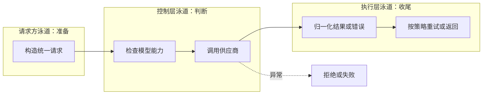

**时序图**。参与者(participants)：调用方、重试器、模型适配器、供应商接口；片段(segments)：请求、执行、返回；消息(messages)：提交统一模型请求、按能力映射请求、发送供应商请求、返回响应或异常、归一化模型结果或错误、成功返回或按策略再试；激活区(activations)：重试器、模型适配器。

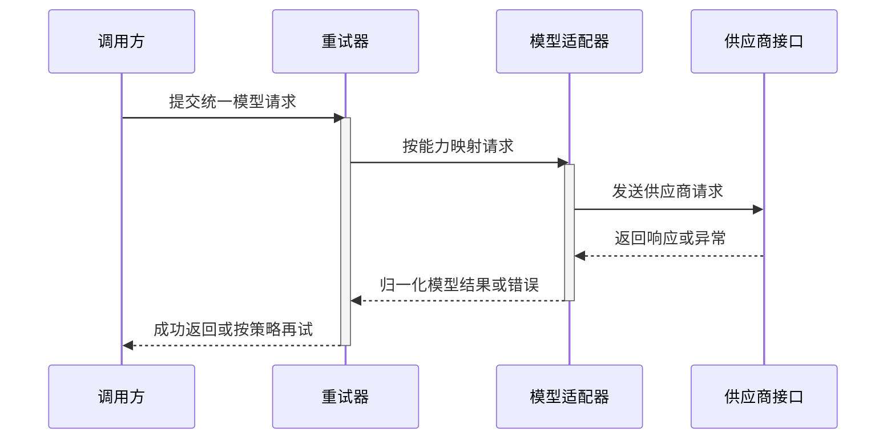

**生命周期图**。泳道(lanes)：控制层、执行层；状态(states)：见图中各状态；迁移(transitions)：一次模型调用；失败按错误是否可重试及预算决定回到调用中或终止。

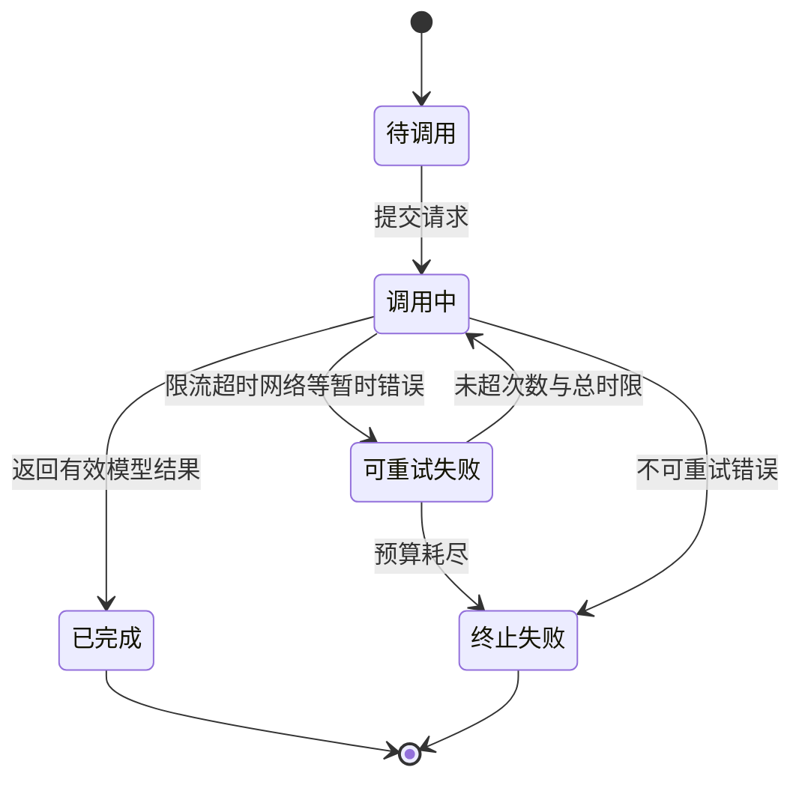

### 1-3 流式运行与事件

**代码依据**：[app.py](./week01/1-3/app.py)、[cli.py](./week01/1-3/cli.py)、[eventsource.js](./week01/1-3/eventsource.js)。

**领域词汇表**

| 术语 | 含义 |
| --- | --- |
| 运行(Run) | 一次流式模型调用 |
| 运行事件(Run Event) | 携带运行号、序号、类型和数据 |
| 订阅者(Subscriber) | 通过服务器发送事件接收运行输出 |
| 取消信号(Cancel Signal) | 请求协作式中止的标记 |

**业务规则**

1. 事件序号递增并保存在运行状态中，可按已接收序号补发。
2. 模型文本增量、用量与结束原因被转换为统一事件；输出截断产生失败事件。
3. 取消产生取消事件并保留部分文本；普通完成与失败都形成终结事件。

#### 功能说明

| 对象与功能 | 运行及验证步骤（PowerShell） | 预期现象 |
| --- | --- | --- |
| `app.py`：提供创建运行、订阅事件、取消运行的网页与应用程序接口。 | 1. `Set-Location course_code/week01/1-3` |  |
|  | 2. 设置 `$env:DEEPSEEK_API_KEY='你的密钥'` |  |
|  | 3. 运行 `python -m uvicorn app:app --reload --port 8000` |  |
|  | 4. 另开终端访问 `http://127.0.0.1:8000/`，提交问题。 | 页面逐条显示事件与增量文本；可断开、重连或取消。 |
| `cli.py`：独立验证模型的流式响应。 | 在同一目录运行 `python -m cli "用一句话介绍流式输出"`。 | 终端逐块显示文本及状态；与网页运行接口是两条独立入口。 |

**架构图**。组件(components)：客户端、运行接口、事件仓库、模型流适配器、订阅通道；边界(boundaries)：调用方、课程实现、外部依赖；连接(connections)：请求、校验、执行与回传。

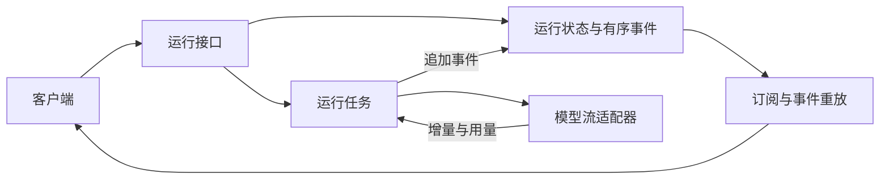

**工作流图**。泳道(lanes)：请求方、控制层、执行层；阶段(phases)：创建运行 → 消费模型流 → 追加有序事件 → 向订阅者推送或重放 → 完成或取消；分组(groups)：准备、执行、收尾；主路径(mainPath)：创建运行 → 消费模型流 → 追加有序事件 → 向订阅者推送或重放 → 完成或取消；节点(nodes)：五个阶段；连线(edges)：顺序推进，异常转入拒绝或失败。

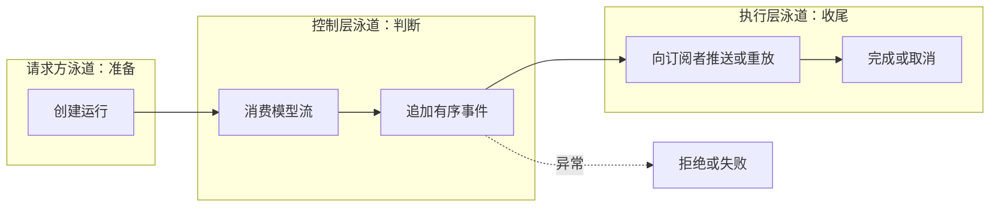

**时序图**。参与者(participants)：客户端、运行接口、运行任务、模型流；片段(segments)：请求、执行、返回；消息(messages)：创建并订阅运行、启动执行、消费增量事件、返回文本增量与用量、追加有序运行事件、推送或重放事件；激活区(activations)：运行接口、运行任务。

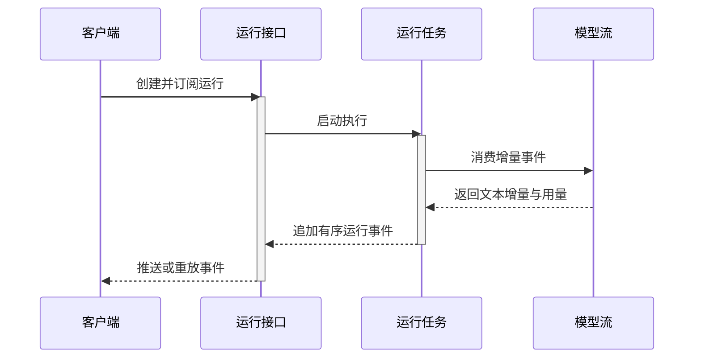

**生命周期图**。泳道(lanes)：运行控制、事件发布；状态(states)：已创建、运行中、已完成、失败、已取消；迁移(transitions)：运行开始后按完成、异常、取消三种条件进入互斥终态。

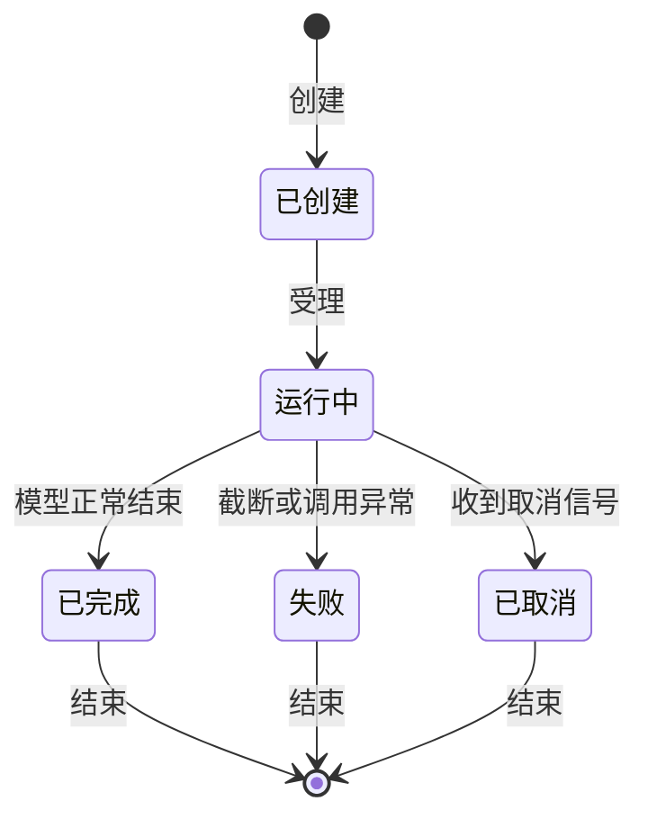

### 1-4 提示词契约

**代码依据**：[typeRender.py](./week01/1-4/typeRender.py)、[StrictUndefined.py](./week01/1-4/StrictUndefined.py)、[eval.py](./week01/1-4/eval.py)。

**领域词汇表**

| 术语 | 含义 |
| --- | --- |
| 提示词上下文(Prompt Context) | 任务、工作区、工具、规则、观察和预算 |
| 可信规则(Trusted Instruction) | 项目规则及运行边界 |
| 观察数据(Untrusted Data) | 工具与仓库返回的事实 |
| 提示词指纹(Prompt Fingerprint) | 渲染文本的哈希 |

**业务规则**

1. 任务和工具列表不能为空，步骤与令牌预算不能为负。
2. 模板缺失变量即报错；观察内容按不可信数据标记，不能改写任务和权限。
3. 先取证再改动，满足验证条件方可结束；渲染后计算指纹供版本比对。

#### 功能说明

| 对象与功能 | 运行及验证步骤（PowerShell） | 预期现象 |
| --- | --- | --- |
| `typeRender.py` 与 `StrictUndefined.py`：校验提示词上下文，渲染受信任规则和不可信观察，并生成指纹。 | 1. `Set-Location course_code/week01/1-4` |  |
|  | 2. 运行 `python -c "from pathlib import Path; from typeRender import PromptContext; from StrictUndefined import render_prompt; p,h=render_prompt(PromptContext('检查登录',Path.cwd(),('read_file',),'只读','',(),3,1000)); print(p); print(h)"`。 | 输出含 `runtime_state`、`observations` 的提示词和 64 位十六进制摘要；这里的文件是可导入模块，没有独立命令行入口。 |

**架构图**。组件(components)：任务输入、上下文校验、模板渲染器、模型、评测器；边界(boundaries)：调用方、课程实现、外部依赖；连接(connections)：请求、校验、执行与回传。

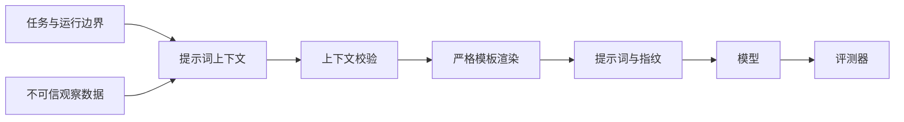

**工作流图**。泳道(lanes)：请求方、控制层、执行层；阶段(phases)：组装上下文 → 验证必填与预算 → 渲染可信和不可信区 → 生成指纹 → 评测输出；分组(groups)：准备、执行、收尾；主路径(mainPath)：组装上下文 → 验证必填与预算 → 渲染可信和不可信区 → 生成指纹 → 评测输出；节点(nodes)：五个阶段；连线(edges)：顺序推进，异常转入拒绝或失败。

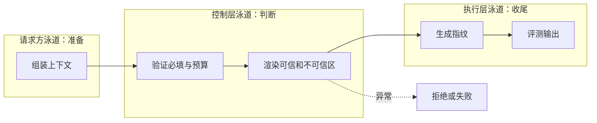

**时序图**。参与者(participants)：任务输入、上下文校验、模板渲染、模型；片段(segments)：请求、执行、返回；消息(messages)：提交任务与运行边界、验证任务工具和预算、渲染可信规则与观察、接收提示词、返回模型输出、交付输出与指纹；激活区(activations)：上下文校验、模板渲染。

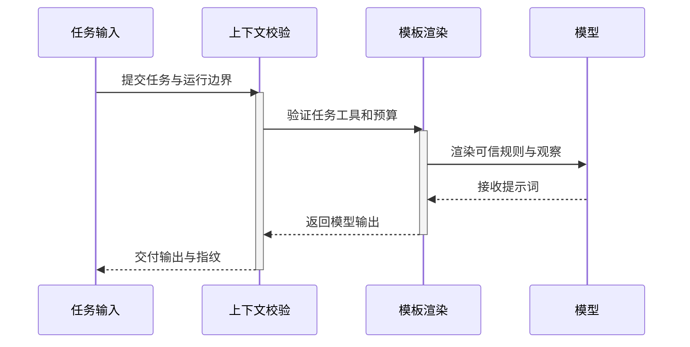

**生命周期图**。泳道(lanes)：控制层、执行层；状态(states)：见图中各状态；迁移(transitions)：提示词上下文经过校验和渲染后才能成为可评测的版本；无效输入退回草稿。

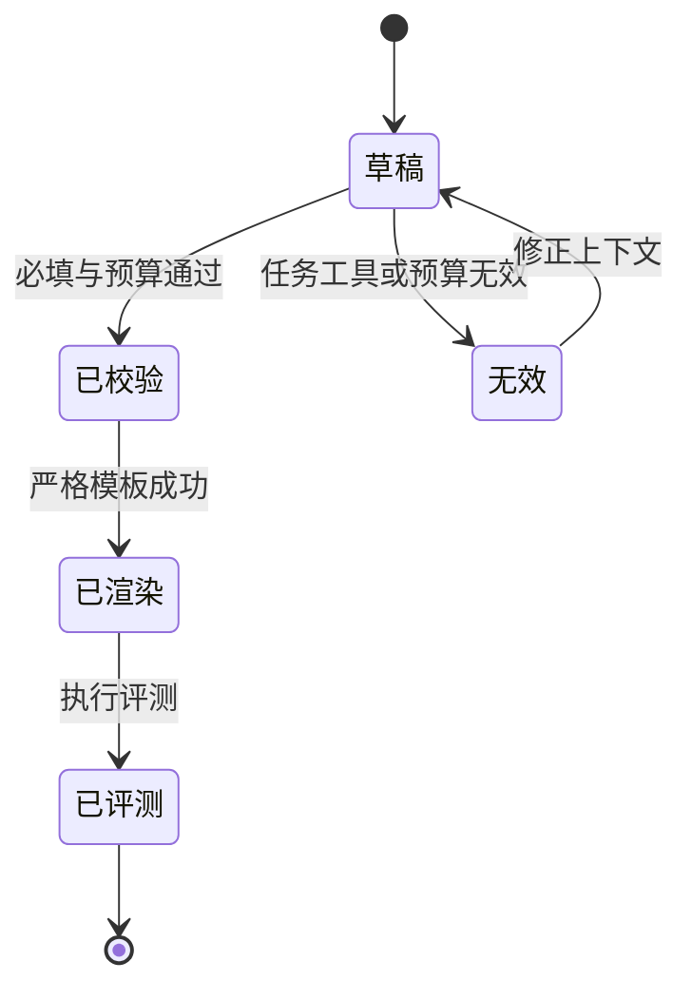

### 1-5 结构化决策

**代码依据**：[fieldrule.py](./week01/1-5/fieldrule.py)、[validationIssue.py](./week01/1-5/validationIssue.py)、[repairloop.py](./week01/1-5/repairloop.py)、[decisionResult.py](./week01/1-5/decisionResult.py)、[cache.py](./week01/1-5/cache.py)。

**领域词汇表**

| 术语 | 含义 |
| --- | --- |
| 代理决策(Agent Decision) | 搜索或结束的互斥动作 |
| 校验问题(Validation Issue) | 格式或字段约束失败 |
| 修复尝试(Repair Attempt) | 一次错误输出与反馈 |
| 决策结果(Decision Result) | 成功决策或降级失败 |

**业务规则**

1. 搜索必须有查询且无答案；结束必须有答案且无查询；禁止额外字段。
2. 模型输出需经解析与领域字段校验；无效输出不触发工具。
3. 最多两次修复反馈；耗尽后给出结构化失败。缓存使用任务键与协议版本。

#### 功能说明

| 对象与功能 | 运行及验证步骤（PowerShell） | 预期现象 |
| --- | --- | --- |
| `fieldrule.py`：用 Pydantic 验证模型决策中动作与字段的组合。 | 1. `Set-Location course_code/week01/1-5` |  |
|  | 2. 运行 `python -m fieldrule`。 | 输出合法的 `search_docs` 决策及结构化字段。 |
| `repairloop.py` 等片段：展示校验失败后的修复、重试及缓存规则。 | 1. 阅读对应函数及示例调用 |  |
|  | 2. 先将缺失的依赖、模型调用方和上下文装配成完整程序后再运行。 | 这些文件不是可直接执行的完整入口，不能把 `python -m repairloop` 当成验收命令。 |

**架构图**。组件(components)：代理循环、模型、结构校验器、修复循环、业务工具；边界(boundaries)：调用方、课程实现、外部依赖；连接(connections)：请求、校验、执行与回传。

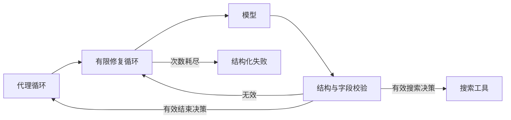

**工作流图**。泳道(lanes)：请求方、控制层、执行层；阶段(phases)：请求结构化决策 → 解析和校验 → 失败时反馈问题 → 有限次重试 → 执行合法动作或降级；分组(groups)：准备、执行、收尾；主路径(mainPath)：请求结构化决策 → 解析和校验 → 失败时反馈问题 → 有限次重试 → 执行合法动作或降级；节点(nodes)：五个阶段；连线(edges)：顺序推进，异常转入拒绝或失败。

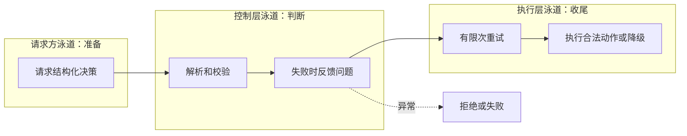

**时序图**。参与者(participants)：代理循环、修复循环、模型、结构校验器；片段(segments)：生成、校验、有限修复；消息(messages)：请求决策、提交任务、原始输出、校验请求、校验结果、合法决策或失败；激活区(activations)：修复循环、模型。

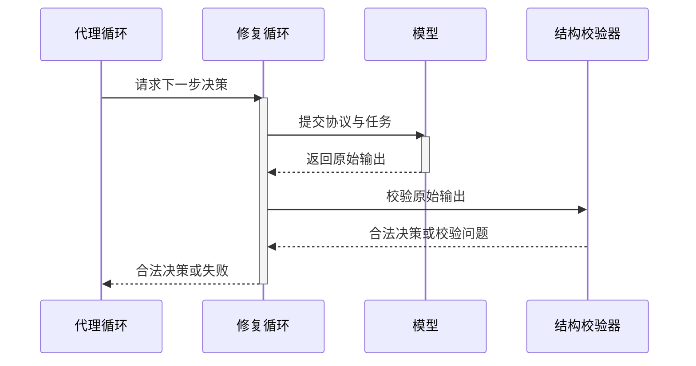

**生命周期图**。泳道(lanes)：控制层、执行层；状态(states)：见图中各状态；迁移(transitions)：一次结构化决策；校验失败会进入有限修复，次数耗尽才降级。

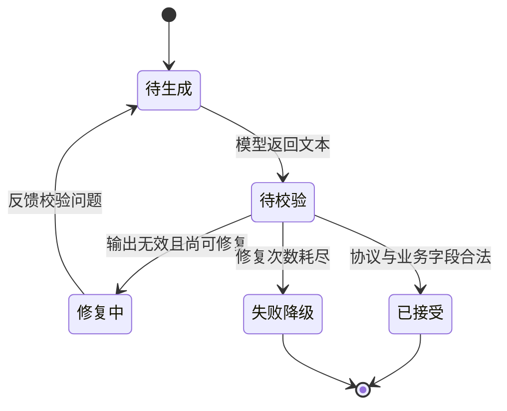

### 1-6 统一模型网关原型

**代码依据**：[gateway.py](./week01/1-6/gateway.py)、[test_gateway.py](./week01/1-6/test_gateway.py)。

**领域词汇表**

| 术语 | 含义 |
| --- | --- |
| 网关请求(LLM Request) | 模型、消息、提示词与响应约束 |
| 提示词模板(Prompt Template) | 可选版本的系统消息来源 |
| 调用轨迹(Call Trace) | 模型、用量、成本、时延与状态 |
| 供应商(Provider) | 可替换的上游调用接口 |

**业务规则**

1. 请求先解析提示词并验证模型及结构化输出能力。
2. 非流式调用按可重试错误切换后备模型；流式请求通过服务器发送事件转发。
3. 每次调用按用量和价格估算成本并记录轨迹。

#### 功能说明

| 对象与功能 | 运行及验证步骤（PowerShell） | 预期现象 |
| --- | --- | --- |
| `gateway.py`：提供统一模型调用、流式返回、提示词模板和轨迹查询接口。 | 1. 运行 `Set-Location course_code/week01/1-6` |  |
|  | 2. 运行 `python -m pip install -r requirements.txt` |  |
|  | 3. 设置 `$env:DEEPSEEK_API_KEY='主密钥'` |  |
|  | 4. 设置 `$env:DEEPSEEK_BACKUP_API_KEY='备用密钥'` |  |
|  | 5. 运行 `python -m uvicorn gateway:app --reload --port 8000` |  |
|  | 6. 另开终端运行 `Invoke-RestMethod http://127.0.0.1:8000/v1/traces`。 | 服务监听 8000 端口；轨迹查询返回列表。 |
| `test_gateway.py`：用模拟供应商验证非流式、流式及输入校验。 | 在同一目录运行 `python -m test_gateway`。 | 输出 `Gateway verification passed`；该测试不依赖真实供应商请求。 |

**架构图**。组件(components)：调用方、接口层、网关服务、提示词仓库、供应商适配器、轨迹仓库；边界(boundaries)：调用方、课程实现、外部依赖；连接(connections)：请求、校验、执行与回传。

```mermaid
flowchart LR
  C["调用方"] --> API["网关接口"]
  API --> G["网关服务"]
  P["提示词模板"] --> G
  G --> V["模型能力校验"]
  V --> U["供应商适配器"]
  U --> M["上游模型"]
  G --> T["调用轨迹"]
  U -->|响应或流| G
  G --> C
```

**工作流图**。泳道(lanes)：请求方、控制层、执行层；阶段(phases)：接收请求 → 渲染提示词与验证模型 → 选择上游 → 调用或流式转发 → 记录用量与响应；分组(groups)：准备、执行、收尾；主路径(mainPath)：接收请求 → 渲染提示词与验证模型 → 选择上游 → 调用或流式转发 → 记录用量与响应；节点(nodes)：五个阶段；连线(edges)：顺序推进，异常转入拒绝或失败。

```mermaid
flowchart LR
  subgraph L1["请求方泳道：准备"]
    N1["接收请求"]
  end
  subgraph L2["控制层泳道：判断"]
    N2["渲染提示词与验证模型"]
    N3["选择上游"]
  end
  subgraph L3["执行层泳道：收尾"]
    N4["调用或流式转发"]
    N5["记录用量与响应"]
  end
  N1 --> N2 --> N3 --> N4 --> N5
  N3 -.异常.-> E["拒绝或失败"]
```

**时序图**。参与者(participants)：调用方、网关接口、网关服务、供应商适配器；片段(segments)：请求、执行、返回；消息(messages)：提交网关请求、转交已解析请求、调用选定模型、返回响应或错误、记录轨迹与用量、返回统一响应或事件流；激活区(activations)：网关接口、网关服务。

```mermaid
sequenceDiagram
  participant U as 调用方
  participant H as 网关接口
  participant R as 网关服务
  participant X as 供应商适配器
  U->>H: 提交网关请求
  activate H
  H->>R: 转交已解析请求
  activate R
  R->>X: 调用选定模型
  X-->>R: 返回响应或错误
  R-->>H: 记录轨迹与用量
  deactivate R
  H-->>U: 返回统一响应或事件流
  deactivate H
```

**生命周期图**。泳道(lanes)：控制层、执行层；状态(states)：见图中各状态；迁移(transitions)：一次网关请求；可重试故障进入后备尝试，成功或失败后记录调用轨迹。

```mermaid
stateDiagram-v2
  [*] --> Route
  state "待路由" as Route
  state "上游调用中" as Calling
  state "后备尝试中" as Fallback
  state "已完成" as Done
  state "失败" as Failed
  Route --> Calling: 模型与能力校验通过
  Route --> Failed: 不支持的模型或输出模式
  Calling --> Done: 上游成功
  Calling --> Fallback: 可重试故障
  Fallback --> Calling: 切换后备目标
  Fallback --> Failed: 无可用目标
  Done --> [*]
  Failed --> [*]
```

### 1-7 可治理模型网关

**代码依据**：[llm-gateway/app/services/gateway.py](./week01/1-7/llm-gateway/app/services/gateway.py)、[llm-gateway/app/services/router.py](./week01/1-7/llm-gateway/app/services/router.py)、[llm-gateway/app/core/security.py](./week01/1-7/llm-gateway/app/core/security.py)、[llm-gateway/app/core/rate_limit.py](./week01/1-7/llm-gateway/app/core/rate_limit.py)、[llm-gateway/app/services/structured.py](./week01/1-7/llm-gateway/app/services/structured.py)。

**领域词汇表**

| 术语 | 含义 |
| --- | --- |
| 模型路由(Model Route) | 逻辑模型到供应商目标的映射 |
| 熔断状态(Circuit State) | 目标健康与暂避状态 |
| 身份(Identity) | 经密钥校验的调用者 |
| 用量事件(Usage Event) | 成本和延迟的持久观测 |
| 提示词记录(Prompt Record) | 版本化模板 |

**业务规则**

1. 接口鉴权并限流，再进入网关服务。
2. 路由依据配置选择目标；上游失败受重试和熔断策略控制，结构化响应另行校验。
3. 已输出的流不能无缝换上游；提供流检查点和用量查询接口。

#### 功能说明

| 对象与功能 | 运行及验证步骤（PowerShell） | 预期现象 |
| --- | --- | --- |
| `llm-gateway`：提供兼容模型接口、路由、限流、故障转移和用量记录。 | 1. 运行 `Set-Location course_code/week01/1-7/llm-gateway` |  |
|  | 2. 运行 `Copy-Item gateway.example.yaml gateway.yaml` |  |
|  | 3. 按示例配置至少一个供应商密钥 |  |
|  | 4. 运行 `python -m pip install -e '.[dev]'` |  |
|  | 5. 设置 `$env:GATEWAY_CONFIG='gateway.yaml'` |  |
|  | 6. 运行 `python -m uvicorn app.main:app --reload --port 8000` |  |
|  | 7. 另开终端访问 `http://127.0.0.1:8000/docs` |  |
|  | 8. 运行 `Invoke-RestMethod http://127.0.0.1:8000/healthz`。 | 文档页面可访问；健康检查返回正常状态。 |
| 自动化验证：接口、路由和错误处理。 | 在项目目录运行 `python -m pytest -q`。 | 测试通过时显示通过数量；真实模型请求仍取决于供应商配置。 |

**架构图**。组件(components)：调用方、鉴权限流边界、网关服务、模型路由器、供应商接口、用量与提示词仓库；边界(boundaries)：调用方、课程实现、外部依赖；连接(connections)：请求、校验、执行与回传。

```mermaid
flowchart LR
  C["调用方"] --> A["鉴权与限流"]
  A --> G["网关服务"]
  G --> P["版本化提示词仓库"]
  G --> R["模型路由与熔断"]
  R --> U["上游供应商"]
  G --> S["结构化结果校验"]
  G --> O["用量事件仓库"]
  G --> C
```

**工作流图**。泳道(lanes)：请求方、控制层、执行层；阶段(phases)：认证限流 → 解析请求与提示词 → 选择健康目标 → 调用及校验 → 记录用量或返回错误；分组(groups)：准备、执行、收尾；主路径(mainPath)：认证限流 → 解析请求与提示词 → 选择健康目标 → 调用及校验 → 记录用量或返回错误；节点(nodes)：五个阶段；连线(edges)：顺序推进，异常转入拒绝或失败。

```mermaid
flowchart LR
  subgraph L1["请求方泳道：准备"]
    N1["认证限流"]
  end
  subgraph L2["控制层泳道：判断"]
    N2["解析请求与提示词"]
    N3["选择健康目标"]
  end
  subgraph L3["执行层泳道：收尾"]
    N4["调用及校验"]
    N5["记录用量或返回错误"]
  end
  N1 --> N2 --> N3 --> N4 --> N5
  N3 -.异常.-> E["拒绝或失败"]
```

**时序图**。参与者(participants)：调用方、鉴权限流、网关服务、模型路由器；片段(segments)：请求、执行、返回；消息(messages)：提交模型请求、认证与配额检查、请求选择目标、返回健康路由、调用上游并校验结果、返回响应或拒绝；激活区(activations)：鉴权限流、网关服务。

```mermaid
sequenceDiagram
  participant U as 调用方
  participant H as 鉴权限流
  participant R as 网关服务
  participant X as 模型路由器
  U->>H: 提交模型请求
  activate H
  H->>R: 认证与配额检查
  activate R
  R->>X: 请求选择目标
  X-->>R: 返回健康路由
  R-->>H: 调用上游并校验结果
  deactivate R
  H-->>U: 返回响应或拒绝
  deactivate H
```

**生命周期图**。泳道(lanes)：控制层、执行层；状态(states)：见图中各状态；迁移(transitions)：一次网关请求；鉴权、路由和调用依次进行，拒绝与失败都是终止分支。

```mermaid
stateDiagram-v2
  [*] --> Auth
  state "待认证" as Auth
  state "待路由" as Route
  state "调用中" as Calling
  state "已完成" as Done
  state "拒绝或失败" as Failed
  Auth --> Route: 身份与配额通过
  Auth --> Failed: 未授权或限流
  Route --> Calling: 选中健康目标
  Route --> Failed: 无可用目标
  Calling --> Done: 结果校验通过
  Calling --> Failed: 上游或结构化校验失败
  Done --> [*]
  Failed --> [*]
```

## week02

### 2-1 工具调用基础协议

**代码依据**：[tool_definition.py](./week02/2-1/tool_definition.py)、[tool_runtime.py](./week02/2-1/tool_runtime.py)、[order_schemas.py](./week02/2-1/order_schemas.py)、[minimal_tool_loop.py](./week02/2-1/minimal_tool_loop.py)。

**领域词汇表**

| 术语 | 含义 |
| --- | --- |
| 工具定义(Tool Definition) | 输入输出模型、权限、风险和执行器 |
| 执行上下文(Execution Context) | 用户、租户、权限、审批和追踪信息 |
| 工具结果(Tool Result) | 关联调用号的成功或错误消息 |
| 暂时故障(Transient Tool Error) | 可能重试的上游失败 |

**业务规则**

1. 模型只看到当前权限允许的工具，执行时再次校验参数与权限。
2. 高风险调用须按调用号审批；输出必须符合输出模型。
3. 仅幂等工具的超时或暂时故障可按预算重试；每次结果写追踪。

#### 功能说明

| 对象与功能 | 运行及验证步骤（PowerShell） | 预期现象 |
| --- | --- | --- |
| `search_orders_tool.py`：定义工具参数、执行上下文和订单查询处理器。 | 1. `Set-Location course_code/week02/2-1` |  |
|  | 2. 运行 `python -m search_orders_tool`。 | 依次显示工具定义、模型参数与运行时上下文、经输出模型验收的订单结果。 |
| `tool_batch.py`：演示一批工具调用的执行与结果对应。 | 1. 在同一目录运行 `python -m tool_batch` |  |
|  | 2. 若验证真实模型循环，设置 `$env:DEEPSEEK_API_KEY='你的密钥'` |  |
|  | 3. 运行 `python -m minimal_tool_loop`。 | 批处理输出每个 `tool_call_id` 的结果；真实模型循环输出最终回答。 |

**架构图**。组件(components)：模型、代理循环、工具运行时、工具注册表、业务处理器、追踪仓库；边界(boundaries)：调用方、课程实现、外部依赖；连接(connections)：请求、校验、执行与回传。

```mermaid
flowchart LR
  M["模型工具提议"] --> L["代理循环"]
  L --> R["工具运行时"]
  D["工具定义与注册表"] --> R
  C["执行上下文"] --> R
  R --> H["业务处理器"]
  R --> T["追踪仓库"]
  R -->|关联调用号的结果| L
```

**工作流图**。泳道(lanes)：请求方、控制层、执行层；阶段(phases)：投影可见工具 → 模型提议调用 → 校验权限及参数 → 执行与校验输出 → 回填结果；分组(groups)：准备、执行、收尾；主路径(mainPath)：投影可见工具 → 模型提议调用 → 校验权限及参数 → 执行与校验输出 → 回填结果；节点(nodes)：五个阶段；连线(edges)：顺序推进，异常转入拒绝或失败。

```mermaid
flowchart LR
  subgraph L1["请求方泳道：准备"]
    N1["投影可见工具"]
  end
  subgraph L2["控制层泳道：判断"]
    N2["模型提议调用"]
    N3["校验权限及参数"]
  end
  subgraph L3["执行层泳道：收尾"]
    N4["执行与校验输出"]
    N5["回填结果"]
  end
  N1 --> N2 --> N3 --> N4 --> N5
  N3 -.异常.-> E["拒绝或失败"]
```

**时序图**。参与者(participants)：模型、代理循环、工具运行时、业务处理器；片段(segments)：请求、执行、返回；消息(messages)：提出带调用号的工具调用、转交调用与上下文、参数权限审批校验后执行、返回业务结果、校验输出并写追踪、回填关联结果；激活区(activations)：代理循环、工具运行时。

```mermaid
sequenceDiagram
  participant U as 模型
  participant H as 代理循环
  participant R as 工具运行时
  participant X as 业务处理器
  U->>H: 提出带调用号的工具调用
  activate H
  H->>R: 转交调用与上下文
  activate R
  R->>X: 参数权限审批校验后执行
  X-->>R: 返回业务结果
  R-->>H: 校验输出并写追踪
  deactivate R
  H-->>U: 回填关联结果
  deactivate H
```

**生命周期图**。泳道(lanes)：控制层、执行层；状态(states)：见图中各状态；迁移(transitions)：工具定义可被发现；每次调用独立经历校验和执行，产生成功或错误结果。

```mermaid
stateDiagram-v2
  [*] --> Registered
  state "已注册" as Registered
  state "可发现" as Visible
  state "待执行" as Pending
  state "执行中" as Running
  state "成功或错误" as Settled
  Registered --> Visible: 当前身份有权限
  Visible --> Pending: 模型提出调用
  Pending --> Running: 参数权限审批通过
  Pending --> Settled: 校验拒绝
  Running --> Settled: 输出通过或执行失败
  Settled --> [*]
```

### 2-2 工具注册与受控执行

**代码依据**：[tool_runtime_demo_v2.py](./week02/2-2/tool_runtime_demo_v2.py)、[tool_runtime_demo.py](./week02/2-2/tool_runtime_demo.py)、[test_tool_runtime_demo_v2.py](./week02/2-2/test_tool_runtime_demo_v2.py)。

**领域词汇表**

| 术语 | 含义 |
| --- | --- |
| 工具注册表(Tool Registry) | 管理工具名与版本 |
| 工具快照(Tool Snapshot) | 单次运行的只读工具视图 |
| 准备调用(Prepared Call) | 校验后等待执行的动作 |
| 工具结果消息(Tool Result Message) | 保留调用号与版本信息 |

**业务规则**

1. 同名同版本不得重复注册；快照只包含已启用路由。
2. 旧快照也受当前停用开关约束；调用前检查参数、权限、审批和依赖健康。
3. 执行有超时，返回后再校验输出；错误按固定代码封装。

#### 功能说明

| 对象与功能 | 运行及验证步骤（PowerShell） | 预期现象 |
| --- | --- | --- |
| `tool_runtime_demo_v2.py`：注册工具、冻结快照、校验调用并把结果写回模型对话。 | 1. `Set-Location course_code/week02/2-2` |  |
|  | 2. 运行 `python -m pip install -r requirements.txt` |  |
|  | 3. 设置 `$env:DEEPSEEK_API_KEY='你的密钥'` |  |
|  | 4. 运行 `python -m tool_runtime_demo_v2`。 | 输出天气与客户资料的综合回答；真实对话需要网络与模型密钥。 |
| `test_tool_runtime_demo_v2.py`：验证受控执行规则。 | 在同一目录运行 `python -m pytest -q test_tool_runtime_demo_v2.py`。 | 显示测试通过数量；可在无真实模型请求的情况下检查运行时规则。 |

**架构图**。组件(components)：代理、工具注册表、只读快照、工具运行时、处理器；边界(boundaries)：调用方、课程实现、外部依赖；连接(connections)：请求、校验、执行与回传。

```mermaid
flowchart LR
  REG["工具注册表"] --> SNAP["只读能力快照"]
  A["代理"] --> SNAP
  A --> RUN["工具运行时"]
  SNAP --> RUN
  LIVE["实时启用与依赖状态"] --> RUN
  RUN --> H["工具处理器"]
  RUN -->|结构化结果| A
```

**工作流图**。泳道(lanes)：请求方、控制层、执行层；阶段(phases)：注册并生成快照 → 模型选择工具 → 准备阶段校验 → 执行阶段超时控制 → 结果封装与审计；分组(groups)：准备、执行、收尾；主路径(mainPath)：注册并生成快照 → 模型选择工具 → 准备阶段校验 → 执行阶段超时控制 → 结果封装与审计；节点(nodes)：五个阶段；连线(edges)：顺序推进，异常转入拒绝或失败。

```mermaid
flowchart LR
  subgraph L1["请求方泳道：准备"]
    N1["注册并生成快照"]
  end
  subgraph L2["控制层泳道：判断"]
    N2["模型选择工具"]
    N3["准备阶段校验"]
  end
  subgraph L3["执行层泳道：收尾"]
    N4["执行阶段超时控制"]
    N5["结果封装与审计"]
  end
  N1 --> N2 --> N3 --> N4 --> N5
  N3 -.异常.-> E["拒绝或失败"]
```

**时序图**。参与者(participants)：代理、工具运行时、工具快照、处理器；片段(segments)：查找、检查、执行；消息(messages)：提交调用与快照、查找工具定义、返回定义、校验后执行、返回原始结果、封装调用结果；激活区(activations)：工具运行时、处理器。

```mermaid
sequenceDiagram
  participant U as 代理
  participant H as 工具运行时
  participant R as 工具快照
  participant X as 处理器
  U->>H: 提交调用与固定快照
  activate H
  H->>R: 查找工具定义
  R-->>H: 返回定义或不存在
  H->>X: 参数权限依赖检查通过后执行
  activate X
  X-->>H: 原始结果
  deactivate X
  H-->>U: 返回调用结果
  deactivate H
```

**生命周期图**。泳道(lanes)：控制层、执行层；状态(states)：见图中各状态；迁移(transitions)：单次工具调用在固定快照上执行；实时停用或前置检查失败会直接拒绝。

```mermaid
stateDiagram-v2
  [*] --> Registered
  state "已注册" as Registered
  state "已快照" as Snapshot
  state "准备中" as Preparing
  state "执行中" as Running
  state "成功" as Done
  state "拒绝或错误" as Failed
  Registered --> Snapshot: 生成只读快照
  Snapshot --> Preparing: 收到工具调用
  Preparing --> Running: 参数权限依赖通过
  Preparing --> Failed: 停用或校验失败
  Running --> Done: 输出校验通过
  Running --> Failed: 超时或输出无效
  Done --> [*]
  Failed --> [*]
```

### 2-3 外部能力接入

**代码依据**：[mcp_host_v1.py](./week02/2-3/mcp_host_v1.py)、[mcp_client_v1.py](./week02/2-3/mcp_client_v1.py)、[mcp_server_v1.py](./week02/2-3/mcp_server_v1.py)、[loop_v1.py](./week02/2-3/loop_v1.py)。

**领域词汇表**

| 术语 | 含义 |
| --- | --- |
| 宿主(Host) | 负责代理循环和能力边界 |
| 客户端(Client) | 连接外部能力服务 |
| 服务端(Server) | 暴露订单工具、资源和提示词 |
| 远端工具(Remote Tool) | 发现后映射到本地运行时的能力 |

**业务规则**

1. 远端发现的工具经允许名单与本地运行时映射后才能提供模型。
2. 参数按发现的模式校验，远端结果归一化并按调用号回填。
3. 订单查询与建单是演示业务能力；代理循环设最大轮数。

#### 功能说明

| 对象与功能 | 运行及验证步骤（PowerShell） | 预期现象 |
| --- | --- | --- |
| `mcp_host_v1.py`：启动本地订单服务进程，发现工具并检查参数、成功和失败路径。 | 1. 运行 `Set-Location course_code/week02/2-3` |  |
|  | 2. 安装本节所需的 `mcp`、`openai` 等依赖 |  |
|  | 3. 运行 `python -m mcp_host_v1`。 | 依次显示 `CONTRACT SUCCESS`、`REJECT`、`FAIL`；未配置模型密钥时显示 `LIVE SKIP`。 |
| 真实代理循环：把外部能力结果送回模型。 | 1. 在同一目录设置 `$env:DEEPSEEK_API_KEY='你的密钥'` |  |
|  | 2. 再次运行 `python -m mcp_host_v1`。 | 额外显示 `LIVE` 回答和调用轨迹；`mcp_server_v1.py` 是由宿主拉起的标准输入输出服务，不单独交互运行。 |

**架构图**。组件(components)：代理宿主、模型、本地工具运行时、外部能力客户端、订单服务端；边界(boundaries)：调用方、课程实现、外部依赖；连接(connections)：请求、校验、执行与回传。

```mermaid
flowchart LR
  U["用户"] --> H["代理宿主"]
  H --> M["模型"]
  H --> R["本地工具运行时"]
  R --> C["外部能力客户端"]
  C --> S["订单能力服务端"]
  S -->|工具、资源与提示词| C
  C -->|归一化结果| R
  R --> H
```

**工作流图**。泳道(lanes)：请求方、控制层、执行层；阶段(phases)：连接并发现 → 筛选工具 → 模型提议调用 → 校验并转发 → 归一化结果回填；分组(groups)：准备、执行、收尾；主路径(mainPath)：连接并发现 → 筛选工具 → 模型提议调用 → 校验并转发 → 归一化结果回填；节点(nodes)：五个阶段；连线(edges)：顺序推进，异常转入拒绝或失败。

```mermaid
flowchart LR
  subgraph L1["请求方泳道：准备"]
    N1["连接并发现"]
  end
  subgraph L2["控制层泳道：判断"]
    N2["筛选工具"]
    N3["模型提议调用"]
  end
  subgraph L3["执行层泳道：收尾"]
    N4["校验并转发"]
    N5["归一化结果回填"]
  end
  N1 --> N2 --> N3 --> N4 --> N5
  N3 -.异常.-> E["拒绝或失败"]
```

**时序图**。参与者(participants)：用户、代理宿主、外部能力客户端、订单服务端；片段(segments)：请求、执行、返回；消息(messages)：提交订单任务、发现或调用允许的工具、发送远端请求、返回远端结果、归一化结果、回填结果并回答；激活区(activations)：代理宿主、外部能力客户端。

```mermaid
sequenceDiagram
  participant U as 用户
  participant H as 代理宿主
  participant R as 外部能力客户端
  participant X as 订单服务端
  U->>H: 提交订单任务
  activate H
  H->>R: 发现或调用允许的工具
  activate R
  R->>X: 发送远端请求
  X-->>R: 返回远端结果
  R-->>H: 归一化结果
  deactivate R
  H-->>U: 回填结果并回答
  deactivate H
```

**生命周期图**。泳道(lanes)：控制层、执行层；状态(states)：见图中各状态；迁移(transitions)：外部能力会话从连接、发现到调用；调用失败回到已发现状态供宿主决定下一步。

```mermaid
stateDiagram-v2
  [*] --> Disconnected
  state "未连接" as Disconnected
  state "已初始化" as Initialized
  state "已发现" as Discovered
  state "调用中" as Calling
  state "完成或失败" as Settled
  Disconnected --> Initialized: 建立外部能力连接
  Initialized --> Discovered: 列出并筛选工具
  Discovered --> Calling: 宿主发起允许的调用
  Calling --> Settled: 远端返回或报错
  Settled --> Discovered: 继续代理循环
  Discovered --> [*]: 关闭会话
```

### 2-4 工具治理

**代码依据**：[tool_governance_demo.py](./week02/2-4/tool_governance_demo.py)、[tool_governance_v2.py](./week02/2-4/tool_governance_v2.py)、[test_tool_governance.py](./week02/2-4/test_tool_governance.py)。

**领域词汇表**

| 术语 | 含义 |
| --- | --- |
| 工具策略(Tool Policy) | 副作用、风险、权限和重试约束 |
| 审批(Approval) | 与规范化参数绑定的一次性决定 |
| 决策审计(Decision Audit) | 放行或拒绝的记录 |
| 执行审计(Execution Audit) | 处理器执行及结果记录 |

**业务规则**

1. 白名单、计划模式、权限、参数和业务预检查依次约束执行。
2. 写操作需审批；参数变更使审批摘要失效，一次性审批不能重放。
3. 非幂等写入的暂时失败不自动重试；模型结果脱敏并标记不可信。
4. 被拒调用只写决策审计，真正执行才写执行审计。

#### 功能说明

| 对象与功能 | 运行及验证步骤（PowerShell） | 预期现象 |
| --- | --- | --- |
| `tool_governance_demo.py`：演示权限、审批、幂等、计划模式及审计记录。 | 1. `Set-Location course_code/week02/2-4` |  |
|  | 2. 运行 `python -m pip install -r requirements.txt` |  |
|  | 3. 运行 `python -m tool_governance_demo`。 | 输出各次工具调用结果及 `side_effects`、`audit_records` 汇总。 |
| 治理规则测试。 | 在同一目录运行 `python -m pytest -q test_tool_governance.py test_tool_governance_v2.py test_audit_v1.py`。 | 测试报告覆盖权限拒绝、审批和审计等路径。 |

**架构图**。组件(components)：代理、策略与权限边界、审批仓库、工具运行时、业务处理器、审计仓库；边界(boundaries)：调用方、课程实现、外部依赖；连接(connections)：请求、校验、执行与回传。

```mermaid
flowchart LR
  A["代理候选调用"] --> R["统一工具运行时"]
  R --> P["白名单与权限策略"]
  R --> V["参数与业务预检查"]
  R --> G["人工审批门"]
  R --> H["业务处理器"]
  R --> O["决策与执行审计"]
  H -->|原始结果| R
  R --> D["脱敏后的模型结果"]
```

**工作流图**。泳道(lanes)：请求方、控制层、执行层；阶段(phases)：发现与白名单 → 校验参数和权限 → 审批及预检查 → 执行或拒绝 → 脱敏并审计；分组(groups)：准备、执行、收尾；主路径(mainPath)：发现与白名单 → 校验参数和权限 → 审批及预检查 → 执行或拒绝 → 脱敏并审计；节点(nodes)：五个阶段；连线(edges)：顺序推进，异常转入拒绝或失败。

```mermaid
flowchart LR
  subgraph L1["请求方泳道：准备"]
    N1["发现与白名单"]
  end
  subgraph L2["控制层泳道：判断"]
    N2["校验参数和权限"]
    N3["审批及预检查"]
  end
  subgraph L3["执行层泳道：收尾"]
    N4["执行或拒绝"]
    N5["脱敏并审计"]
  end
  N1 --> N2 --> N3 --> N4 --> N5
  N3 -.异常.-> E["拒绝或失败"]
```

**时序图**。参与者(participants)：代理、工具运行时、策略与审批、业务处理器；片段(segments)：策略检查、可选执行、审计返回；消息(messages)：候选工具调用、策略与审批检查、返回决定、放行时执行、原始结果、脱敏并审计后的结果；激活区(activations)：工具运行时、业务处理器。

```mermaid
sequenceDiagram
  participant U as 代理
  participant H as 工具运行时
  participant R as 策略与审批
  participant X as 业务处理器
  U->>H: 提出候选工具调用
  activate H
  H->>R: 校验白名单权限与参数
  R-->>H: 放行、拒绝或待确认
  opt 策略放行
    H->>X: 执行业务处理器
    activate X
    X-->>H: 原始结果
    deactivate X
  end
  H-->>U: 脱敏并写审计后回传
  deactivate H
```

**生命周期图**。泳道(lanes)：控制层、执行层；状态(states)：见图中各状态；迁移(transitions)：候选调用按策略放行、待审批或拒绝；只有放行后才执行处理器。

```mermaid
stateDiagram-v2
  [*] --> Candidate
  state "候选调用" as Candidate
  state "待审批" as Approval
  state "已放行" as Allowed
  state "执行中" as Running
  state "已完成" as Done
  state "已拒绝" as Denied
  Candidate --> Approval: 高风险写操作
  Candidate --> Allowed: 策略直接放行
  Candidate --> Denied: 白名单权限或预检查失败
  Approval --> Allowed: 一次性审批绑定一致
  Approval --> Denied: 拒绝或参数变化
  Allowed --> Running: 调用处理器
  Running --> Done: 脱敏并审计结果
  Running --> Denied: 执行失败
  Done --> [*]
  Denied --> [*]
```

### 2-5 代理工具基础设施第二版

**代码依据**：[agent-tool-runtime-pi-v2-修复超时 bug.zip](./week02/2-5/agent-tool-runtime-pi-v2-修复超时%20bug.zip)。

**领域词汇表**

| 术语 | 含义 |
| --- | --- |
| 能力快照(Capability Snapshot) | 模型可见工具的固定集合 |
| 命名投影(Name Mapping) | 本地与外部工具名的映射 |
| 待审批动作(Pending Approval) | 绑定参数、身份和追踪的暂停调用 |
| 循环保护(Loop Guard) | 限制工具和轮次预算 |

**业务规则**

1. 压缩包内网关、命令行、编码代理扩展与审批接口共用工具运行时。
2. 外部未知工具默认高风险并要求确认；处理器前重新校验经钩子修改的参数。
3. 仅幂等且可重试的动作自动重试；流已发出后不切换模型。
4. 审批与用户、租户、追踪、调用和参数摘要绑定；审计敏感字段脱敏。

#### 功能说明

| 对象与功能 | 运行及验证步骤（PowerShell） | 预期现象 |
| --- | --- | --- |
| 修复版压缩包中的 `runtime`：工具注册、执行、审批与外部能力集成；本节源码以压缩包交付。 | 1. 从仓库根目录运行 `Expand-Archive -LiteralPath 'course_code/week02/2-5/agent-tool-runtime-pi-v2-修复超时 bug.zip' -DestinationPath "$env:TEMP/week02-2-5" -Force` |  |
|  | 2. 运行 `Set-Location "$env:TEMP/week02-2-5/agent-tool-runtime-pi-v2/runtime"` |  |
|  | 3. 运行 `npm ci` |  |
|  | 4. 运行 `npm run build` |  |
|  | 5. 运行 `npm test`。 | 构建及测试通过；此步骤使用修复超时问题的压缩包，需 Node.js 22.19 及以上版本和 npm。 |
| 命令行工具清单。 | 在同一 `runtime` 目录运行 `npm run cli -- tools --without-mcp`。 | 显示本地已注册工具；接入外部能力前还需按压缩包内说明启动配套服务。 |

**架构图**。组件(components)：命令行或编码代理、模型网关、能力快照、工具运行时、外部能力服务、审批与审计仓库；边界(boundaries)：调用方、课程实现、外部依赖；连接(connections)：请求、校验、执行与回传。

```mermaid
flowchart LR
  A["命令行或编码代理"] --> L["代理循环"]
  L --> G["模型网关"]
  L --> S["能力快照"]
  S --> R["共享工具运行时"]
  R --> P["策略与审批"]
  R --> M["本地或外部能力工具"]
  R --> O["审计与追踪"]
  R -->|工具结果| L
```

**工作流图**。泳道(lanes)：请求方、控制层、执行层；阶段(phases)：装载平台配置 → 发现并固定能力 → 模型选择工具 → 策略校验和审批 → 执行回填与审计；分组(groups)：准备、执行、收尾；主路径(mainPath)：装载平台配置 → 发现并固定能力 → 模型选择工具 → 策略校验和审批 → 执行回填与审计；节点(nodes)：五个阶段；连线(edges)：顺序推进，异常转入拒绝或失败。

```mermaid
flowchart LR
  subgraph L1["请求方泳道：准备"]
    N1["装载平台配置"]
  end
  subgraph L2["控制层泳道：判断"]
    N2["发现并固定能力"]
    N3["模型选择工具"]
  end
  subgraph L3["执行层泳道：收尾"]
    N4["策略校验和审批"]
    N5["执行回填与审计"]
  end
  N1 --> N2 --> N3 --> N4 --> N5
  N3 -.异常.-> E["拒绝或失败"]
```

**时序图**。参与者(participants)：命令行或编码代理、代理循环、工具运行时、审批仓库；片段(segments)：请求、治理、返回；消息(messages)：提交任务、转交模型提出的工具调用、查询或创建审批、返回批准或待审批、执行或挂起并记录审计、返回工具结果或审批号；激活区(activations)：代理循环、工具运行时。

```mermaid
sequenceDiagram
  participant U as 命令行或编码代理
  participant H as 代理循环
  participant R as 工具运行时
  participant X as 审批仓库
  U->>H: 提交任务
  activate H
  H->>R: 转交模型提出的工具调用
  activate R
  R->>X: 查询或创建审批
  X-->>R: 返回批准或待审批
  R-->>H: 执行或挂起并记录审计
  deactivate R
  H-->>U: 返回工具结果或审批号
  deactivate H
```

**生命周期图**。泳道(lanes)：能力治理、执行控制；状态(states)：待装载、已快照、待审批、执行中、已完成、已拒绝；迁移(transitions)：低风险调用直接执行，高风险调用等待审批。

```mermaid
stateDiagram-v2
  [*] --> S0: 创建
  state "待装载" as S0
  state "已快照" as S1
  state "待审批" as S2
  state "执行中" as S3
  state "已完成" as S4
  state "已拒绝" as S5
  S0 --> S1: 受理
  S1 --> S2: 需要确认
  S1 --> S3: 无需确认且策略放行
  S2 --> S3: 批准且绑定一致
  S2 --> S5: 拒绝或绑定失效
  S3 --> S4: 执行并审计
  S3 --> S5: 执行失败
  S4 --> [*]: 结束
  S5 --> [*]: 结束
```

## week03

### 3-1 代码理解代理循环

**代码依据**：[codebasedemo/src/agent-runner.ts](./week03/3-1/codebasedemo/src/agent-runner.ts)、[codebasedemo/src/loop-guard.ts](./week03/3-1/codebasedemo/src/loop-guard.ts)、[codebasedemo/src/runtime.ts](./week03/3-1/codebasedemo/src/runtime.ts)、[login_demo/src/services/auth-service.ts](./week03/3-1/login_demo/src/services/auth-service.ts)。

**领域词汇表**

| 术语 | 含义 |
| --- | --- |
| 运行上下文(Run Context) | 目标仓库、工具和产物位置 |
| 循环状态(Loop State) | 轮次、指纹与证据 |
| 完成条件(Completion Condition) | 源码阅读量与文档产物要求 |
| 登录示例(Login Demo) | 被分析的认证仓库 |

**业务规则**

1. 模型工具调用经本地运行时执行，结果回写上下文再继续。
2. 最多轮次、重复动作和完成条件阻止空转或过早结束。
3. 代码理解至少读取三个相关源码文件并生成登录流程文档。

#### 功能说明

| 对象与功能 | 运行及验证步骤（PowerShell） | 预期现象 |
| --- | --- | --- |
| `codebasedemo`：代理循环调用代码读取、搜索和执行工具，并限制重复动作。 | 1. 运行 `Set-Location course_code/week03/3-1/codebasedemo` |  |
|  | 2. 运行 `node --version`，确认版本至少 22.19 |  |
|  | 3. 运行 `npm ci` |  |
|  | 4. 运行 `npm run build` |  |
|  | 5. 运行 `npm test`。 | 构建与测试通过，覆盖代码工具和循环边界。 |
| 真实模型演示入口 `src/main.ts`。 | 1. 配置并启动第一周的模型网关 |  |
|  | 2. 按本项目说明设置 `GATEWAY_BASE_URL`、`GATEWAY_API_KEY` |  |
|  | 3. 运行 `npm start`。 | 终端显示代理工具调用和代码理解结果；目标仓库为本节示例工作区。 |

**架构图**。组件(components)：用户、模型网关、代理循环、循环保护器、代码工具运行时、目标仓库；边界(boundaries)：调用方、课程实现、外部依赖；连接(connections)：请求、校验、执行与回传。

```mermaid
flowchart LR
  U["用户"] --> L["代理循环"]
  L --> G["模型网关"]
  L --> R["代码工具运行时"]
  R --> REPO["目标仓库"]
  L --> GUARD["循环保护"]
  R -->|工具结果| L
  L --> ART["登录流程文档"]
```

**工作流图**。泳道(lanes)：请求方、控制层、执行层；阶段(phases)：加载任务与工具 → 读取搜索源码 → 回填工具结果 → 写入说明文档 → 检验完成条件；分组(groups)：准备、执行、收尾；主路径(mainPath)：加载任务与工具 → 读取搜索源码 → 回填工具结果 → 写入说明文档 → 检验完成条件；节点(nodes)：五个阶段；连线(edges)：顺序推进，验收不足则继续循环。

```mermaid
flowchart LR
  subgraph L1["请求方泳道：准备"]
    N1["加载任务与工具"]
  end
  subgraph L2["控制层泳道：判断"]
    N2["读取搜索源码"]
    N3["回填工具结果"]
  end
  subgraph L3["执行层泳道：收尾"]
    N4["写入说明文档"]
    N5["检验完成条件"]
  end
  N1 --> N2 --> N3 --> N4 --> N5
  N3 -.异常.-> E["拒绝或失败"]
```

**时序图**。参与者(participants)：用户、代理循环、代码工具运行时、目标仓库；片段(segments)：请求、治理、返回；消息(messages)：提交代码理解任务、请求读取或搜索源码、访问目标文件、返回源码证据、回填结果并检查完成条件、返回文档或继续运行；激活区(activations)：代理循环、代码工具运行时。

```mermaid
sequenceDiagram
  participant U as 用户
  participant H as 代理循环
  participant R as 代码工具运行时
  participant X as 目标仓库
  U->>H: 提交代码理解任务
  activate H
  H->>R: 请求读取或搜索源码
  activate R
  R->>X: 访问目标文件
  X-->>R: 返回源码证据
  R-->>H: 回填结果并检查完成条件
  deactivate R
  H-->>U: 返回文档或继续运行
  deactivate H
```

**生命周期图**。泳道(lanes)：控制层、执行层；状态(states)：见图中各状态；迁移(transitions)：代理轮次在模型与工具之间循环；完成条件通过才进入完成态。

```mermaid
stateDiagram-v2
  [*] --> Ready
  state "待开始" as Ready
  state "运行中" as Running
  state "等待工具" as Tool
  state "待验收" as Verify
  state "已完成" as Done
  state "停止" as Stopped
  Ready --> Running: 接收任务
  Running --> Tool: 模型提出工具调用
  Tool --> Running: 工具结果回填
  Running --> Verify: 模型提出结束
  Verify --> Done: 阅读与产物条件满足
  Verify --> Running: 证据不足并可继续
  Running --> Stopped: 达到轮次或重复动作保护
  Done --> [*]
  Stopped --> [*]
```

### 3-2 计划与任务拆解

**代码依据**：[planning_agent_demo/src/plan-store.ts](./week03/3-2/planning_agent_demo/src/plan-store.ts)、[planning_agent_demo/src/plan-tools.ts](./week03/3-2/planning_agent_demo/src/plan-tools.ts)、[planning_agent_demo/src/completion-contract.ts](./week03/3-2/planning_agent_demo/src/completion-contract.ts)、[planning_agent_demo/src/agent-runner.ts](./week03/3-2/planning_agent_demo/src/agent-runner.ts)。

**领域词汇表**

| 术语 | 含义 |
| --- | --- |
| 计划(Plan) | 目标、版本、步骤和修订预算 |
| 计划步骤(Plan Step) | 依赖、状态与验收标准 |
| 证据(Evidence) | 工具、测试、差异或检查记录 |
| 完成契约(Completion Contract) | 任务级验收规则 |

**业务规则**

1. 步骤只有依赖全部完成才可启动；略过步骤不满足下游依赖。
2. 完成步骤必须提交同一步骤的有效证据；测试和差异证据须对应当前代码版本。
3. 修订要求原因与已知证据，候选计划通过唯一标识、依赖存在和无环校验后原子提交。
4. 修复任务必须有有效改动、规定范围通过的测试及交付说明。

#### 功能说明

| 对象与功能 | 运行及验证步骤（PowerShell） | 预期现象 |
| --- | --- | --- |
| `planning_agent_demo`：在代理循环上增加计划、步骤证据与完成条件。 | 1. 运行 `Set-Location course_code/week03/3-2/planning_agent_demo` |  |
|  | 2. 运行 `node --version`，确认版本至少 22.19 |  |
|  | 3. 运行 `npm ci` |  |
|  | 4. 运行 `npm run build` |  |
|  | 5. 运行 `npm test`。 | 测试报告覆盖计划状态和任务完成条件。 |
| 真实模型任务入口。 | 1. 启动模型网关 |  |
|  | 2. 配置 `GATEWAY_BASE_URL`、`GATEWAY_API_KEY` |  |
|  | 3. 运行 `npm start`。 | 终端按计划输出步骤、工具执行和验证证据。 |

**架构图**。组件(components)：代理循环、计划工具、计划仓库、证据仓库、完成契约、目标仓库；边界(boundaries)：调用方、课程实现、外部依赖；连接(connections)：请求、校验、执行与回传。

```mermaid
flowchart LR
  L["代理循环"] --> P["计划工具"]
  P --> S["计划仓库"]
  L --> R["代码工具运行时"]
  R --> REPO["目标仓库"]
  R --> E["证据仓库"]
  S --> C["完成契约"]
  E --> C
  C -->|缺项或通过| L
```

**工作流图**。泳道(lanes)：请求方、控制层、执行层；阶段(phases)：创建六步计划 → 按依赖启动步骤 → 调用工具并收集证据 → 校验或修订计划 → 验收并交付；分组(groups)：准备、执行、收尾；主路径(mainPath)：创建六步计划 → 按依赖启动步骤 → 调用工具并收集证据 → 校验或修订计划 → 验收并交付；节点(nodes)：五个阶段；连线(edges)：顺序推进，异常转入拒绝或失败。

```mermaid
flowchart LR
  subgraph L1["请求方泳道：准备"]
    N1["创建六步计划"]
  end
  subgraph L2["控制层泳道：判断"]
    N2["按依赖启动步骤"]
    N3["调用工具并收集证据"]
  end
  subgraph L3["执行层泳道：收尾"]
    N4["校验或修订计划"]
    N5["验收并交付"]
  end
  N1 --> N2 --> N3 --> N4 --> N5
  N3 -.异常.-> E["拒绝或失败"]
```

**时序图**。参与者(participants)：代理循环、计划工具、计划仓库、证据仓库；片段(segments)：请求、治理、返回；消息(messages)：创建或推进计划、提交步骤更新、读取步骤证据、返回已绑定证据、校验依赖与版本后完成或拒绝、返回计划快照；激活区(activations)：计划工具、计划仓库。

```mermaid
sequenceDiagram
  participant U as 代理循环
  participant H as 计划工具
  participant R as 计划仓库
  participant X as 证据仓库
  U->>H: 创建或推进计划
  activate H
  H->>R: 提交步骤更新
  activate R
  R->>X: 读取步骤证据
  X-->>R: 返回已绑定证据
  R-->>H: 校验依赖与版本后完成或拒绝
  deactivate R
  H-->>U: 返回计划快照
  deactivate H
```

**生命周期图**。泳道(lanes)：控制层、执行层；状态(states)：见图中各状态；迁移(transitions)：计划步骤的生命周期；依赖全部完成后才能启动，完成要求当前版本的证据。

```mermaid
stateDiagram-v2
  [*] --> Pending
  state "待执行" as Pending
  state "执行中" as Running
  state "已完成" as Done
  state "失败" as Failed
  state "阻塞" as Blocked
  state "略过" as Skipped
  Pending --> Running: 依赖全部完成
  Running --> Done: 同步骤有效证据齐全
  Running --> Failed: 执行失败
  Pending --> Blocked: 依赖或外部条件不满足
  Pending --> Skipped: 无下游依赖
  Failed --> Pending: 有证据地修订计划
  Done --> [*]
  Blocked --> [*]
  Skipped --> [*]
```

### 3-3 任务状态与检查点

**代码依据**：[planning_agent_demo/src/task-record.ts](./week03/3-3/planning_agent_demo/src/task-record.ts)、[planning_agent_demo/src/checkpoint.ts](./week03/3-3/planning_agent_demo/src/checkpoint.ts)、[planning_agent_demo/src/resume.ts](./week03/3-3/planning_agent_demo/src/resume.ts)、[planning_agent_demo/src/approval-flow.ts](./week03/3-3/planning_agent_demo/src/approval-flow.ts)。

**领域词汇表**

| 术语 | 含义 |
| --- | --- |
| 任务记录(Task Record) | 运行状态、计数、步骤和迁移历史 |
| 检查点(Checkpoint) | 原子保存的业务现场 |
| 待审批补丁(Pending Approval) | 与参数及文件内容哈希绑定的修改 |
| 恢复检查(Resume Inspection) | 判定动作已完成、未开始或结果不明 |

**业务规则**

1. 等待审批和暂停不是失败；完成、失败和取消是终态。
2. 工具成功不等于步骤完成，完成取决于证据与测试退出码。
3. 恢复前校验检查点和工作区现场；结果不明须人工核查。
4. 审批与补丁哈希绑定；恢复时不沿用内存批准状态，预算与迁移序号保持连续。

#### 功能说明

| 对象与功能 | 运行及验证步骤（PowerShell） | 预期现象 |
| --- | --- | --- |
| `planning_agent_demo`：任务状态、检查点、暂停恢复与审批。 | 1. 运行 `Set-Location course_code/week03/3-3/planning_agent_demo` |  |
|  | 2. 运行 `node --version`，确认版本至少 22.19 |  |
|  | 3. 运行 `npm ci` |  |
|  | 4. 运行 `npm run build` |  |
|  | 5. 运行 `npm test`。 | 测试覆盖检查点校验、恢复判断和审批路径。 |
| 脚本化模型实验入口 `scripts/child-run.ts`：无需真实模型即可复现暂停和续跑。 | 1. 在同一目录运行 `$ws=Join-Path $env:TEMP 'course-week03-3-3'` |  |
|  | 2. `npm exec -- tsx scripts/child-run.ts --scenario ac_full --workspace $ws --run-id lesson --pause-after 6 --auto-approve` |  |
|  | 3. 再运行 `npm exec -- tsx scripts/child-run.ts --scenario ac_full --workspace $ws --resume lesson --auto-approve`。 | 首次运行写入检查点并暂停；第二次读取同一工作区的记录并继续。 |

**架构图**。组件(components)：命令行、代理循环、任务记录器、检查点仓库、恢复检查器、审批门；边界(boundaries)：调用方、课程实现、外部依赖；连接(connections)：请求、校验、执行与回传。

```mermaid
flowchart LR
  CLI["命令行"] --> L["代理循环"]
  L --> REC["任务记录器"]
  REC --> CP["检查点仓库"]
  CLI --> RES["恢复检查器"]
  CP --> RES
  RES --> W["工作区现场"]
  L --> A["审批门"]
  A --> W
```

**工作流图**。泳道(lanes)：请求方、控制层、执行层；阶段(phases)：执行与记录迁移 → 原子写检查点 → 暂停或待审批 → 恢复时检查现场 → 续跑或拒绝恢复；分组(groups)：准备、执行、收尾；主路径(mainPath)：执行与记录迁移 → 原子写检查点 → 暂停或待审批 → 恢复时检查现场 → 续跑或拒绝恢复；节点(nodes)：五个阶段；连线(edges)：顺序推进，异常转入拒绝或失败。

```mermaid
flowchart LR
  subgraph L1["请求方泳道：准备"]
    N1["执行与记录迁移"]
  end
  subgraph L2["控制层泳道：判断"]
    N2["原子写检查点"]
    N3["暂停或待审批"]
  end
  subgraph L3["执行层泳道：收尾"]
    N4["恢复时检查现场"]
    N5["续跑或拒绝恢复"]
  end
  N1 --> N2 --> N3 --> N4 --> N5
  N3 -.异常.-> E["拒绝或失败"]
```

**时序图**。参与者(participants)：命令行、恢复检查器、检查点仓库、工作区；片段(segments)：请求、现场核对、返回；消息(messages)：提交恢复请求、读取并校验检查点、核对工作区指纹、返回现场信息、判定可续跑或需核查、返回恢复决定；激活区(activations)：恢复检查器、检查点仓库。

```mermaid
sequenceDiagram
  participant U as 命令行
  participant H as 恢复检查器
  participant R as 检查点仓库
  participant X as 工作区
  U->>H: 提交恢复请求
  activate H
  H->>R: 读取并校验检查点
  activate R
  R->>X: 核对工作区指纹
  X-->>R: 返回现场信息
  R-->>H: 判定可续跑或需核查
  deactivate R
  H-->>U: 返回恢复决定
  deactivate H
```

**生命周期图**。泳道(lanes)：控制层、执行层；状态(states)：运行中、等待工具、等待审批、暂停、完成或失败或取消；迁移(transitions)：按主路径推进，异常进入失败或拒绝分支。

```mermaid
stateDiagram-v2
  [*] --> R: 启动
  state "运行中" as R
  state "等待工具" as T
  state "等待审批" as A
  state "暂停" as P
  state "已完成" as C
  state "失败" as F
  state "已取消" as X
  R --> T: 发出工具调用
  T --> R: 工具结果已记录
  R --> A: 补丁待人工批准
  A --> R: 批准且哈希一致
  A --> P: 拒绝或现场不明
  R --> P: 预算耗尽或结果不明
  P --> R: 核对现场后恢复
  R --> C: 完成契约通过
  R --> F: 不可恢复失败
  R --> X: 人工取消
  C --> [*]
  F --> [*]
  X --> [*]
```

### 3-4 沙箱执行边界

**代码依据**：[opensandbox-demo/sandbox_demo.py](./week03/3-4/opensandbox-demo/sandbox_demo.py)、[opensandbox-demo/sandbox.toml](./week03/3-4/opensandbox-demo/sandbox.toml)、[pi-boundary-demo/artifacts/ok.txt](./week03/3-4/pi-boundary-demo/artifacts/ok.txt)。

**领域词汇表**

| 术语 | 含义 |
| --- | --- |
| 沙箱(Sandbox) | 受资源和文件边界限制的执行环境 |
| 宿主标记(Host Marker) | 用于验证隔离的宿主文件 |
| 执行结果(Execution Result) | 容器内测试退出码和错误输出 |
| 资源配额(Resource Quota) | 处理器与内存限制 |

**业务规则**

1. 演示容器按固定镜像、三分钟期限及资源配额创建。
2. 执行固定测试程序，不拼接模型生成的命令；验证容器看不到宿主标记。
3. 取回结果后核对测试退出码及宿主文件未改，最终显式销毁容器。

#### 功能说明

| 对象与功能 | 运行及验证步骤（PowerShell） | 预期现象 |
| --- | --- | --- |
| `opensandbox-demo/sandbox_demo.py`：创建隔离容器，在容器中运行固定测试，再检查宿主文件不可见并销毁容器。 | 1. 先按本节 `sandbox.toml` 配好可访问的 OpenSandbox 服务及容器运行环境 |  |
|  | 2. `Set-Location course_code/week03/3-4/opensandbox-demo` |  |
|  | 3. 安装 `opensandbox` 依赖 |  |
|  | 4. 运行 `python -m sandbox_demo`。 | 终端显示 `CREATED`、`VERIFIED: test passed; host marker absent in container` 和 `DESTROYED`。 |
| 结果核查。 | 在同一目录运行 `Get-Content sandbox-result.json` 及 `Get-Content host-only-marker.txt`。 | 结果中的 `exit_code` 为 0、`host_visible` 为 `false`，宿主标记仍是 `host-original`。 |

**架构图**。组件(components)：宿主脚本、沙箱服务、容器、固定测试程序、结果文件；边界(boundaries)：调用方、课程实现、外部依赖；连接(connections)：请求、校验、执行与回传。

```mermaid
flowchart LR
  H["宿主脚本"] --> S["沙箱服务"]
  S --> C["受资源限制的容器"]
  H -->|写入固定测试| C
  C -->|结果文件| H
  H -->|显式销毁| S
  MARK["宿主标记文件"] -.不可见.-> C
```

**工作流图**。泳道(lanes)：请求方、控制层、执行层；阶段(phases)：创建容器 → 写入固定测试 → 容器执行 → 取回并核对 → 销毁容器；分组(groups)：准备、执行、收尾；主路径(mainPath)：创建容器 → 写入固定测试 → 容器执行 → 取回并核对 → 销毁容器；节点(nodes)：五个阶段；连线(edges)：顺序推进，异常转入拒绝或失败。

```mermaid
flowchart LR
  subgraph L1["请求方泳道：准备"]
    N1["创建容器"]
  end
  subgraph L2["控制层泳道：判断"]
    N2["写入固定测试"]
    N3["容器执行"]
  end
  subgraph L3["执行层泳道：收尾"]
    N4["取回并核对"]
    N5["销毁容器"]
  end
  N1 --> N2 --> N3 --> N4 --> N5
  N3 -.异常.-> E["拒绝或失败"]
```

**时序图**。参与者(participants)：宿主脚本、沙箱服务、容器、固定测试程序；片段(segments)：请求、执行、返回；消息(messages)：创建受限容器、启动容器、写入并执行固定测试、返回退出码及结果文件、取回并验证宿主隔离、显式销毁容器；激活区(activations)：沙箱服务、容器。

```mermaid
sequenceDiagram
  participant U as 宿主脚本
  participant H as 沙箱服务
  participant R as 容器
  participant X as 固定测试程序
  U->>H: 创建受限容器
  activate H
  H->>R: 启动容器
  activate R
  R->>X: 写入并执行固定测试
  X-->>R: 返回退出码及结果文件
  R-->>H: 取回并验证宿主隔离
  deactivate R
  H-->>U: 显式销毁容器
  deactivate H
```

**生命周期图**。泳道(lanes)：控制层、执行层；状态(states)：见图中各状态；迁移(transitions)：沙箱容器从创建、执行、核验到显式销毁；异常也进入销毁流程。

```mermaid
stateDiagram-v2
  [*] --> New
  state "未创建" as New
  state "已创建" as Created
  state "执行中" as Running
  state "已验证" as Verified
  state "失败" as Failed
  state "已销毁" as Destroyed
  New --> Created: 创建受限容器
  Created --> Running: 写入并运行固定测试
  Running --> Verified: 退出码与隔离检查通过
  Running --> Failed: 测试或隔离检查失败
  Verified --> Destroyed: 显式清理
  Failed --> Destroyed: 最终清理
  Destroyed --> [*]
```

### 3-5 完整代理框架与商业代理参照

**代码依据**：[harness_agent/src/completion-contract.ts](./week03/3-5/harness_agent/src/completion-contract.ts)、[harness_agent/src/test-process.ts](./week03/3-5/harness_agent/src/test-process.ts)、[harness_agent/src/resume.ts](./week03/3-5/harness_agent/src/resume.ts)、[commerce-agents/shopping-agent/runtime-messages-api/shopping_agent_runtime/orchestrator.py](./week03/3-5/commerce-agents/shopping-agent/runtime-messages-api/shopping_agent_runtime/orchestrator.py)、[commerce-agents/merchant-agent/core/merchant_agent/changes.py](./week03/3-5/commerce-agents/merchant-agent/core/merchant_agent/changes.py)。

**领域词汇表**

| 术语 | 含义 |
| --- | --- |
| 验证摘要(Verification Digest) | 源码、测试和配置的内容指纹 |
| 测试证据(Test Evidence) | 范围、退出码与受测内容绑定的记录 |
| 工具结果(Tool Outcome) | 供模型与宿主分别消费的执行结果 |
| 变更账本(Change Ledger) | 商家写入的暂存记录 |

**业务规则**

1. 每个测试范围取最新一次结果；取消、失败或输入变化不能沿用旧通过证据。
2. 完成条件核对当前源码与差异、测试输入指纹、交付文件内容和计划步骤。
3. 取消信号覆盖实际测试进程；恢复前先检查工作区与未决动作。
4. 商业代理示例将商家写操作暂存待人工批准；购物结算只呈现购物车，由宿主完成交易。

#### 功能说明

| 对象与功能 | 运行及验证步骤（PowerShell） | 预期现象 |
| --- | --- | --- |
| `harness_agent`：将模型、工具、治理、任务记录和验证串成完整代理框架。 | 1. 运行 `Set-Location course_code/week03/3-5/harness_agent` |  |
|  | 2. 运行 `node --version`，确认版本至少 22.19 |  |
|  | 3. 运行 `npm ci` |  |
|  | 4. 运行 `npm run build` |  |
|  | 5. 运行 `npm test` |  |
|  | 6. 运行 `npm run lab:harness`。 | 构建和测试通过；脚本化实验输出代理运行与验证记录，无需真实模型。 |
| `commerce-agents`：作为购物代理和商家代理的业务参照工程。 | 1. 从上一行的 `harness_agent` 目录运行 `Set-Location ../../../..`，返回仓库根目录 |  |
|  | 2. 运行 `Set-Location course_code/week03/3-5/commerce-agents` |  |
|  | 3. 运行 `python -m pip install -r requirements.txt` |  |
|  | 4. 运行 `npm ci --prefix examples` |  |
|  | 5. 设置 `$env:ANTHROPIC_API_KEY='你的密钥'` |  |
|  | 6. 运行 `python scripts/run_demo.py retail`。 | 启动零售示例接口和前端；该工程需要真实密钥及网络，业务后端为示例数据。 |

**架构图**。组件(components)：用户或商家、代理框架、模型接口、治理和工具执行、验证与检查点、业务后端；边界(boundaries)：调用方、课程实现、外部依赖；连接(connections)：请求、校验、执行与回传。

```mermaid
flowchart LR
  U["用户或商家"] --> H["代理框架"]
  H --> M["模型接口"]
  H --> R["治理后的工具执行"]
  R --> B["业务后端"]
  R --> E["证据与测试进程"]
  H --> C["完成契约"]
  E --> C
  H --> CP["检查点与恢复"]
  R --> A["审批或变更暂存"]
```

**工作流图**。泳道(lanes)：请求方、控制层、执行层；阶段(phases)：建立计划与上下文 → 调用工具或暂存变更 → 收集最新验证证据 → 检查审批和恢复现场 → 验收或继续循环；分组(groups)：准备、执行、收尾；主路径(mainPath)：建立计划与上下文 → 调用工具或暂存变更 → 收集最新验证证据 → 检查审批和恢复现场 → 验收或继续循环；节点(nodes)：五个阶段；连线(edges)：顺序推进，异常转入拒绝或失败。

```mermaid
flowchart LR
  subgraph L1["请求方泳道：准备"]
    N1["建立计划与上下文"]
  end
  subgraph L2["控制层泳道：判断"]
    N2["调用工具或暂存变更"]
    N3["收集最新验证证据"]
  end
  subgraph L3["执行层泳道：收尾"]
    N4["检查审批和恢复现场"]
    N5["验收或继续循环"]
  end
  N1 --> N2 --> N3 --> N4 --> N5
  N3 -.异常.-> E["拒绝或失败"]
```

**时序图**。参与者(participants)：用户或商家、代理框架、工具治理层、业务后端；片段(segments)：请求、治理、返回；消息(messages)：提交任务、模型提出工具动作、检查来源、策略与审批、查询或暂存变更、回填结果并核对最新证据、返回答复或待审批状态；激活区(activations)：代理框架、工具治理层。

```mermaid
sequenceDiagram
  participant U as 用户或商家
  participant H as 代理框架
  participant R as 工具治理层
  participant X as 业务后端
  U->>H: 提交任务
  activate H
  H->>R: 模型提出工具动作
  activate R
  R->>X: 检查来源、策略与审批
  X-->>R: 查询或暂存变更
  R-->>H: 回填结果并核对最新证据
  deactivate R
  H-->>U: 返回答复或待审批状态
  deactivate H
```

**生命周期图**。泳道(lanes)：控制层、执行层；状态(states)：运行中、等待工具、等待审批、暂停、完成或失败或取消；迁移(transitions)：按主路径推进，异常进入失败或拒绝分支。

```mermaid
stateDiagram-v2
  [*] --> R: 启动
  state "运行中" as R
  state "等待工具" as T
  state "等待审批" as A
  state "暂停" as P
  state "已完成" as C
  state "失败" as F
  state "已取消" as X
  R --> T: 发出工具调用
  T --> R: 工具结果已记录
  R --> A: 补丁待人工批准
  A --> R: 批准且哈希一致
  A --> P: 拒绝或现场不明
  R --> P: 预算耗尽或结果不明
  P --> R: 核对现场后恢复
  R --> C: 完成契约通过
  R --> F: 不可恢复失败
  R --> X: 人工取消
  C --> [*]
  F --> [*]
  X --> [*]
```
